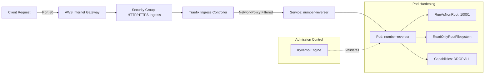

# Number Reverser — Secure Cloud Service

A production-grade, hardened microservice designed and packaged according to regulated environment standards. The application reverses numbers while wrapping the workload in automated Infrastructure-as-Code (Terraform), continuous security gating (Trivy, Syft, Cosign), Kubernetes policy enforcement (Kyverno), and zero-trust network segmentation.

---

## Architecture Overview

```text
                               +-------------------------------------------------+
                               |                   AWS Cloud                     |
                               |  VPC (10.20.0.0/16)                             |
                               |                                                 |
  Internet                     |   Public Subnet (10.20.1.0/24)                  |
     │                         |   +-------------------------------------------+ |
     │ HTTP:80                 |   | EC2 Instance (k3s Node - t3.medium)       | |
     ▼                         |   |                                           | |
[ Internet Gateway ] ─────────►│   | [Traefik Ingress Controller]              | |
                               |   |              │                            | |
                               |   |              ▼ (Port 8000)                | |
                               |   | [NetworkPolicy: Ingress / DNS only]       | |
                               |   |              │                            | |
                               |   |              ▼                            | |
                               |   | [Pod: number-reverser (Non-Root 10001)]   | |
                               |   |  - Read-Only Root FS                      | |
                               |   |  - Dropped ALL Capabilities               | |
                               |   |  - Resource Limits Enforced               | |
                               |   |  - Health Probes (/health)                | |
                               |   |                                           | |
                               |   | [Kyverno Policy Engine (Admission Webhook)| |
                               |   |  - Disallow Privileged                    | |
                               |   |  - Require Non-Root                       | |
                               |   |  - Require Resource Requests & Limits     | |
                               |   |  - Disallow :latest Image Tags            | |
                               |   +-------------------------------------------+ |
                               |                        ▲                        |
                               +────────────────────────┼────────────────────────+
                                                        │ AWS Systems Manager (SSM)
                                                        │ (No open SSH/22 or K8s/6443)
                                               [ Administrator ]
```



---

## Part 01 · Application Specification & Edge Case Handling

The service exposes an HTTP API built on FastAPI, serving both JSON endpoints and a responsive, zero-dependency browser interface.

### Edge Case Policy & Decisions

| Edge Case | Request Example | Handled Result | Rationale & Specification |
| :--- | :--- | :--- | :--- |
| **Negative Numbers** | `{"number": -123}` | `{"input": -123, "reversed": -321}` | Preserves mathematical sign. The sign is extracted, absolute digits reversed, and original polarity restored. |
| **Trailing Zeros** | `{"number": 1200}` | `{"input": 1200, "reversed": 21}` | Standard numerical reversal. Integer representation drops leading zeros naturally (`0021` becomes integer `21`). |
| **Leading Zeros in JSON** | `00123` | Rejected / Parsed as `123` | Valid JSON numbers disallow leading zeroes (RFC 8259). Pydantic `StrictInt` enforces numerical adherence. |
| **Zero (0)** | `{"number": 0}` | `{"input": 0, "reversed": 0}` | Identity element. Reversing zero yields zero. |
| **Non-Numeric Input** | `{"number": "abc"}` or `{"number": 12.5}` | `HTTP 422 Unprocessable Entity` | Strict type schema enforcement via Pydantic `StrictInt` and `extra="forbid"`. Prevents type coercion and string injection. |
| **Input Integer Overflow** | `{"number": 9223372036854775808}` | `HTTP 422 (Out of Range)` | Bound to signed 64-bit integer boundaries ($[-2^{63}, 2^{63}-1]$). Python handles arbitrary precision integers, so explicit threshold bounds protect downstream systems. |
| **Reversed Integer Overflow** | `{"number": 8999999999999999999}` | `HTTP 422 (Reversed Overflow)` | Reversing this valid 64-bit integer produces a number exceeding $2^{63}-1$. The service detects post-reversal overflow and safely rejects with HTTP 422. |

### API Endpoints

- `GET /`: Interactive web UI for browser-based testing.
- `GET /health`: Liveness and readiness health probe (returns `{"status": "ok"}`).
- `POST /reverse`: Reversal endpoint accepting `{"number": <int>}`.

---

## Part 02 · Infrastructure as Code (Terraform)

All infrastructure is provisioned strictly through modular Terraform code located in `infra/`.

### Module Topology
- `infra/modules/networking`: Custom VPC (`10.20.0.0/16`), single availability zone public subnet (`10.20.1.0/24`), Internet Gateway, and associated routing tables.
- `infra/modules/security`: AWS Security Group enforcing strict ingress (ports 80 and 443 only) and explicit egress (ports 80, 443, and 53 UDP/TCP for DNS resolution). **Port 22 (SSH) and Port 6443 (Kubernetes API) are intentionally closed to the internet.**
- `infra/modules/iam`: EC2 IAM Role and Instance Profile with `AmazonSSMManagedInstanceCore` for secure, bastionless console access via AWS Systems Manager.
- `infra/modules/compute`: Ubuntu 24.04 LTS `t3.medium` compute instance with IMDSv2 enforced (`http_tokens = "required"`), encrypted gp3 EBS storage (30 GiB), and automated cloud-init bootstrap (`user_data.sh`) installing k3s and Kyverno.

### State Management Strategy
- **Default Local State**: Configured by default for individual evaluation on trial credits to guarantee zero ongoing cloud expenditure or abandoned state bucket charges.
- **Production State**: A documented turnkey template (`infra/environments/dev/backend.tf.example`) provides remote S3 state storage with server-side encryption and DynamoDB distributed state locking.

---

## Part 03 · Delivery Pipeline (CI/CD)

The GitHub Actions delivery pipeline enforces supply chain security through automated gates. A critical failure at any stage halts the pipeline immediately.

```text
[ Lint ] ──► [ Unit Test ] ──► [ IaC Scan ] ──► [ Container Build ]
                                                        │
                                                        ▼
[ Deploy ] ◄── [ Verify Sign ] ◄── [ Cosign Sign ] ◄── [ Image Scan & SBOM ]
```

1. **Linting & Unit Tests**: Enforced with `ruff` and `pytest`.
2. **IaC Vulnerability Scan**: Scans Terraform code with `trivy config` (`--exit-code 1 --severity HIGH,CRITICAL`).
3. **Container Build**: Builds minimal OCI image from `Dockerfile` (`python:3.13-slim`, non-root user `10001:10001`).
4. **Container Image Scan**: Scans built image with Trivy, gating the build on `CRITICAL` findings.
5. **Software Bill of Materials (SBOM)**: Generates SPDX-JSON SBOM using Syft (`anchore/sbom-action`) and attaches it as a pipeline build artifact.
6. **Keyless Image Signing**: Signs the image using **Cosign** backed by GitHub Actions OIDC identity tokens (Sigstore Fulcio + Rekor transparency log).
7. **Signature Verification**: Verifies cryptographic OIDC signature against the GitHub repository workflow identity before deploying.
8. **Deployment Validation**: Renders Kubernetes manifests with Kustomize and performs automated validation / rollout.

---

## Part 04 · Kubernetes Security & Policy Enforcement

### 1. Workload Hardening (`k8s/base/deployment.yaml`)
- **Pod Security Standards**: Namespace is labeled with `pod-security.kubernetes.io/enforce: restricted`.
- **User Isolation**: Runs as non-root UID `10001`, GID `10001`, `runAsNonRoot: true`.
- **Filesystem**: `readOnlyRootFilesystem: true` with a dedicated `10Mi` in-memory `emptyDir` mounted at `/tmp`.
- **Capabilities**: All Linux kernel capabilities dropped (`drop: ["ALL"]`), `allowPrivilegeEscalation: false`.
- **Seccomp**: `seccompProfile.type: RuntimeDefault`.
- **Resource Governance**: Explicit requests (`100m` CPU, `128Mi` RAM) and limits (`250m` CPU, `256Mi` RAM).

### 2. Zero-Trust Network Segmentation (`k8s/base/networkpolicy.yaml`)
- Default deny policy for all undeclared traffic.
- Ingress allowed **strictly on TCP port 8000**.
- Egress strictly locked down to **UDP/TCP port 53** directed to `kube-system` CoreDNS pods. Pods cannot initiate unauthorized external connections or lateral cluster hops.

### 3. Admission Control (Kyverno Policies in `k8s/policies/`)
- `disallow-privileged`: Rejects any pod with `privileged: true`.
- `require-run-as-non-root`: Rejects containers running as root or without explicit non-root declarations.
- `require-resource-limits`: Rejects any container lacking CPU/memory requests or limits.
- `disallow-latest-tag`: Rejects deployment manifests using `:latest` tags.

### 4. Secret Management
- Zero secrets committed to git.
- Stub template provided in `k8s/base/secrets.template.yaml` for environment variable injection, designed for production integration with External Secrets Operator (ESO) and AWS Secrets Manager.

---

## Stand Up and Verification Guide

### Prerequisites
- AWS CLI configured with administrator or provisioning credentials.
- Terraform `>= 1.9.0`.
- `kubectl` `>= 1.28`.

### 1. Provision Infrastructure
```bash
cd infra/environments/dev
terraform init
terraform plan -out=tfplan
terraform apply tfplan
```
*Note output variables: `ec2_public_ip` and `ec2_instance_id`.*

### 2. Verify Node Bootstrap
Connect to the instance via AWS Systems Manager Session Manager (no SSH key required):
```bash
aws ssm start-session --target <EC2_INSTANCE_ID>
```
Check bootstrap progress:
```bash
tail -f /var/log/user-data.log
kubectl get nodes
```

### 3. Deploy Kubernetes Workloads & Policies (via ArgoCD GitOps or Kustomize)
From the EC2 instance (or your workstation targeting kubeconfig):

**Option A — ArgoCD GitOps Sync (Recommended):**
```bash
# Register ArgoCD applications for continuous GitOps reconciliation
kubectl apply -f argocd/policies-application.yaml
kubectl apply -f argocd/application.yaml

# Check ArgoCD sync status
kubectl get applications -n argocd
```

**Option B — Direct Kustomize Apply:**
```bash
# Apply Kyverno admission policies
kubectl apply -k k8s/policies/

# Apply Number Reverser service and NetworkPolicy
kubectl apply -k k8s/base/
```

### 4. Test the Service
```bash
# Verify pods are running and healthy
kubectl get pods -n number-reverser
kubectl get svc -n number-reverser

# Test HTTP API via public IP
curl -X POST http://<EC2_PUBLIC_IP>/reverse \
  -H "Content-Type: application/json" \
  -d '{"number": 12345}'
# Expected response: {"input":12345,"reversed":54321}

# Test Edge Case: Negative Number
curl -X POST http://<EC2_PUBLIC_IP>/reverse \
  -H "Content-Type: application/json" \
  -d '{"number": -1200}'
# Expected response: {"input":-1200,"reversed":-21}

# Test Edge Case: Out of range
curl -X POST http://<EC2_PUBLIC_IP>/reverse \
  -H "Content-Type: application/json" \
  -d '{"number": 99999999999999999999}'
# Expected response: HTTP 422 Unprocessable Entity
```

---

## Teardown Guide

To prevent recurring cloud charges, destroy all provisioned resources cleanly:

```bash
cd infra/environments/dev
terraform destroy -auto-approve
```

Verify that all AWS resources (EC2 instance, security groups, VPC, IGW, and IAM role) are terminated.

---

## Architectural Decisions & Trade-Offs

1. **K3s on EC2 vs Managed EKS**:
   - *Decision*: Single-node k3s deployed on an AWS `t3.medium` instance.
   - *Trade-off*: Managed EKS has a mandatory \$73/month control plane baseline cost and slow provisioning cycles (15–20 minutes), making it incompatible with a $0 free-tier trial requirement. K3s runs a CNCF-certified Kubernetes engine in under 60 seconds with full CRD and admission controller support.
2. **AWS Systems Manager (SSM) vs SSH Bastion**:
   - *Decision*: Zero open SSH ports (Port 22 closed in Security Group); administration managed via IAM-governed AWS SSM.
   - *Trade-off*: Eliminates SSH key management, credential leakage risks, and public attack surfaces, while maintaining full audit logging through AWS CloudTrail.
3. **Kyverno vs OPA Gatekeeper**:
   - *Decision*: Kyverno declarative YAML policies over OPA/Rego.
   - *Trade-off*: Kyverno policies are native Kubernetes custom resources that require no external DSL (Rego) compilation. This improves maintainability and auditability for platform engineering teams while providing full policy enforcement.
4. **Keyless Signing (Cosign + GitHub OIDC) vs Long-Lived Private Key**:
   - *Decision*: Keyless image signing via Sigstore and GitHub Actions OIDC identity.
   - *Trade-off*: Avoids storing and rotating long-lived cryptographic private keys in CI secrets. Cryptographic signatures are tied directly to the short-lived GitHub Actions workflow token and recorded on the public Rekor transparency log.

